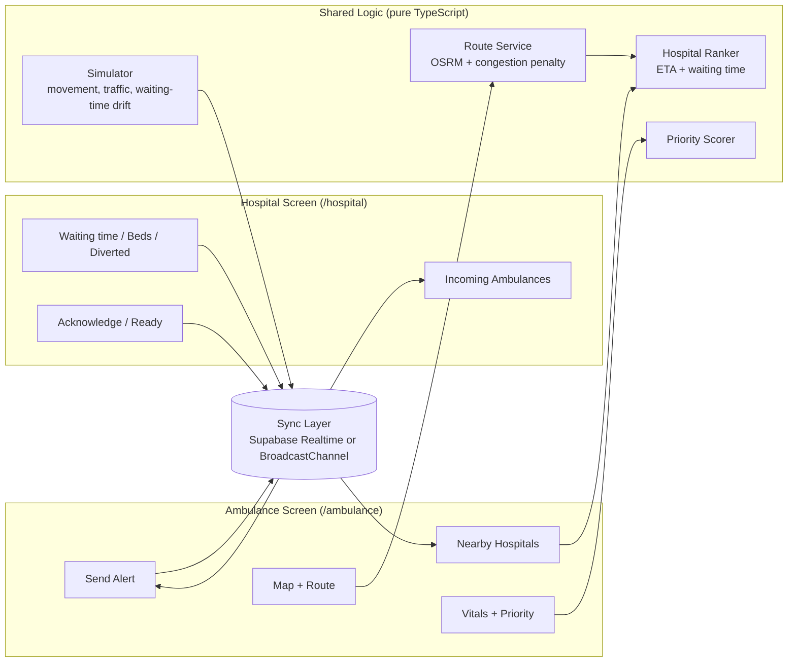
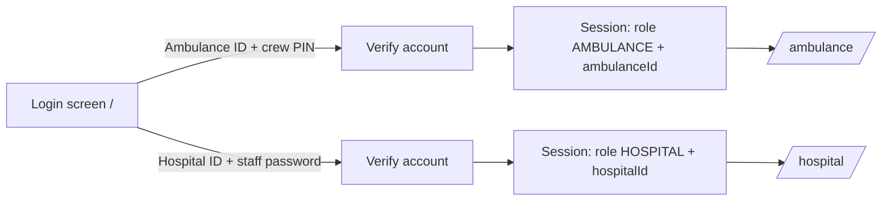
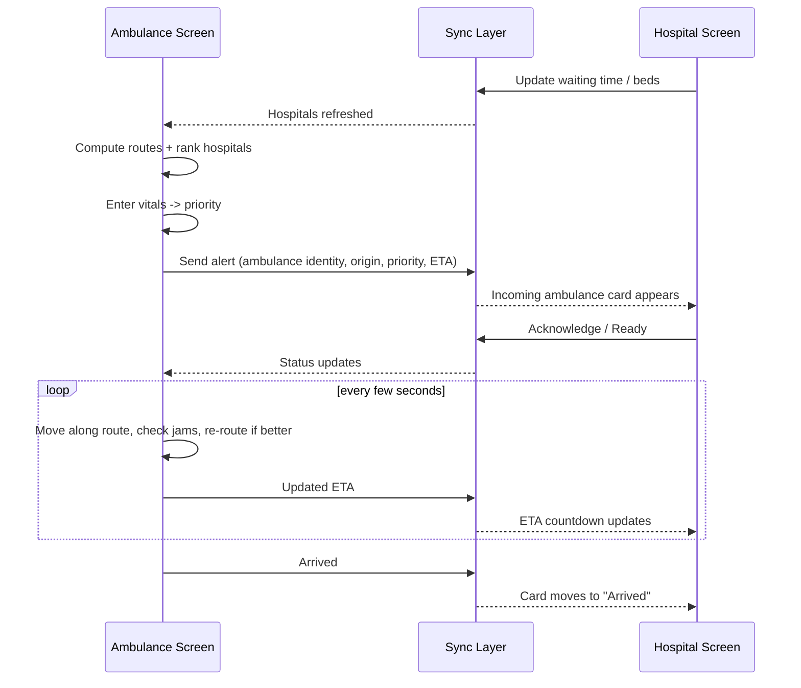

# Jyva — Architecture

Slim two-screen version: **Ambulance Screen** (landscape dashboard for a PC or in-vehicle display, controls on the left and navigator map on the right) and **Hospital Screen** (desktop dashboard), kept in sync through a shared state layer.

## 1. Architecture Goals
- Simple enough to build and demo quickly.
- No paid API keys.
- Two devices (or two browser tabs) stay in sync in near real time.
- Every decision (route choice, hospital rank, priority) comes with a readable reason.
- Simulated data sits behind small interfaces so real sources can replace it later.

## 2. System Overview



## 3. Tech Stack

| Layer | Choice | Why |
|---|---|---|
| Framework | Next.js (App Router) + TypeScript | UI + API routes in one repo, Vercel-ready |
| Styling | Tailwind CSS + shadcn/ui | Fast, clean dashboard UI |
| Map | MapLibre GL JS (`maplibre-gl`) + OpenFreeMap bright vector tiles (fallback: OSM raster) | Free, no API key, vector-rendered clean Google Maps navigation aesthetic with simulated traffic congestion |
| Routing | OSRM public demo server (`steps=true`, `alternatives=true`) + dynamic congestion penalty | Real roads, turn maneuvers, free; see §6 |
| State | Zustand | Simple client store |
| Sync | **Supabase Realtime** (free tier) for two devices; **BroadcastChannel** fallback for two tabs on one machine | Needed so hospital edits reach the ambulance and vice versa |
| Testing | Vitest | Unit tests for ranking and priority logic |
| Deploy | Vercel | One-click |

> The OSRM public demo server is meant for light, demo use and may rate-limit or go down. Cache the routes used in your demo scenario as JSON and fall back to them if the request fails.

## 4. Folder Structure

```
jyva/
├─ README.md
├─ PRD.md
├─ architecture.md
├─ src/
│  ├─ app/
│  │  ├─ page.tsx                  # login: choose Ambulance / Hospital, then sign in
│  │  ├─ ambulance/page.tsx
│  │  ├─ hospital/page.tsx
│  │  └─ api/
│  │     └─ route/route.ts         # proxy to OSRM + cache + fallback
│  ├─ components/
│  │  ├─ map/ (MapView, RouteLayer, HospitalMarker, AmbulanceMarker, JamLayer)
│  │  ├─ ambulance/ (RouteCard, HospitalList, VitalsForm, PriorityBadge, SendAlertButton, StatusStepper)
│  │  ├─ hospital/ (StatusPanel, IncomingList, AmbulanceCard)
│  │  └─ ui/
│  ├─ engine/
│  │  ├─ route.ts        # fetch routes, apply congestion penalty, choose best
│  │  ├─ rank.ts         # hospital ranking
│  │  ├─ priority.ts     # vitals -> Critical/Urgent/Stable + reasons
│  │  └─ sim.ts          # ambulance movement, traffic jitter, waiting-time drift
│  ├─ sync/
│  │  ├─ syncAdapter.ts          # interface
│  │  ├─ supabaseSync.ts
│  │  └─ broadcastSync.ts
│  ├─ auth/ (session.ts, guards.ts)   # login, session, role-based route guards
│  ├─ store/ (useJyvaStore.ts)
│  ├─ data/ (hospitals.json, ambulances.json, accounts.json, cachedRoutes.json)
│  └─ lib/ (types.ts, geo.ts)
└─ tests/
```

## 5. Data Models

```ts
type LatLng = { lat: number; lng: number };
type Priority = 'CRITICAL' | 'URGENT' | 'STABLE';
type CaseType = 'CARDIAC' | 'TRAUMA' | 'STROKE' | 'MATERNITY' | 'OTHER';

interface Hospital {
  id: string;
  name: string;
  pos: LatLng;
  specialties: CaseType[];
  waitingMin: number;        // editable from Hospital Screen
  freeErBeds: number;        // editable
  freeIcuBeds: number;       // editable
  diverted: boolean;         // editable
}

interface Ambulance {
  id: string;                // e.g. "AMB-014"
  plate: string;
  callSign: string;
  operator: {
    type: 'HOSPITAL' | 'GOVT_108' | 'PRIVATE';
    name: string;            // e.g. "Jyva Demo Hospital A" or "108 Service"
  };
  baseHospitalId?: string;   // which hospital this ambulance belongs to (if any)
  pos: LatLng;
}

interface Account {
  id: string;                          // "AMB-014" or "HOSP-SION"
  role: 'AMBULANCE' | 'HOSPITAL';
  secretHash: string;                  // hashed crew PIN or hospital password
  ambulanceId?: string;                // links to Ambulance when role = AMBULANCE
  hospitalId?: string;                 // links to Hospital when role = HOSPITAL
}

interface Trip {
  id: string;
  ambulanceId: string;
  origin:
    | { type: 'SCENE'; label: string; pos: LatLng }
    | { type: 'HOSPITAL_TRANSFER'; hospitalId: string; pos: LatLng };
  destinationHospitalId?: string;
  caseType: CaseType;
  vitals?: { hr: number; sbp: number; spo2: number; gcs: number; ts: number };
  priority?: Priority;
  priorityReasons?: string[];
  etaSec?: number;
  routeId?: string;
  status: 'PICKED_UP' | 'ALERT_SENT' | 'ACKNOWLEDGED' | 'HOSPITAL_READY' | 'ARRIVED';
  updatedAt: number;
}
```

The **Hospital Screen** builds each incoming card by joining `Trip` → `Ambulance` (ID, plate, operator, base hospital) and → `origin` (scene or transferring hospital).

## 6. Routing

1. Request routes from OSRM: origin → hospital with `alternatives=true`.
2. For each candidate route, compute `adjustedEta = osrmDuration × timeOfDayFactor + jamPenalty`, where `jamPenalty` is added for every simulated jam zone (a circle on the map) the route's geometry passes through.
3. Choose the route with the lowest `adjustedEta`.
4. **Re-route rule:** re-check every ~10 s of simulated time or when a jam is added. Switch only if the new route is at least **15% or 60 s faster**.
5. "Time saved" = `defaultRouteEta (no jam awareness) − chosenRouteEta`.

Fallback: if OSRM fails, use `cachedRoutes.json` for the seeded demo trips.

**Simulated Traffic & Navigation Visualization:**
- Route lines are split into 150–250 m segments and dynamically styled in MapLibre GL JS using data-driven GeoJSON expressions.
- Traffic colors are simulated: **green** (clear flow), **orange** (slow), and **red** (heavy bottleneck). Injected traffic jams dynamically flag affected corridor segments as heavy red congestion.
- Traversed segments are drawn in faded grey, and alternative detours appear in subtle grey alongside a "X min saved" callout.

## 7. Hospital Ranking

```
totalMin = etaMin + waitingMin
eligible = !diverted
        && specialties.includes(caseType)      // skipped for OTHER
        && freeErBeds > 0                      // CRITICAL/URGENT: also require beds
rank     = eligible hospitals sorted by totalMin ascending
```

- Ties broken by shorter ETA.
- Top result gets a **Recommended** badge and reason text: `"{eta} min away + {wait} min wait = {total} min, {specialty} available"`.
- Ranking recalculates whenever ETA changes or any hospital updates its status (via sync).
- If the destination hospital becomes diverted or its wait rises sharply, the ambulance screen shows a warning and the next-best hospital.

## 8. Patient Priority (Light, Explainable)

Simple threshold rules, evaluated from most severe to least:

| Priority | Any of these |
|---|---|
| **CRITICAL** | SpO₂ < 90, systolic BP < 90, GCS ≤ 8, HR > 130 or < 40 |
| **URGENT** | SpO₂ 90–93, systolic BP 90–100, GCS 9–13, HR 111–130 or 40–50 |
| **STABLE** | none of the above |

- Case type can raise priority by one level (e.g., stroke or cardiac with any abnormal vital).
- Output includes `priorityReasons[]` such as `"SpO₂ 88% (< 90)"`.
- Thresholds live in one config object so they are easy to tune.
- The UI always shows: *Demo decision-support only, not medical advice.*

## 9. Sync Layer

```ts
interface SyncAdapter {
  publish(channel: 'hospitals' | 'trips', payload: unknown): void;
  subscribe(channel: 'hospitals' | 'trips', cb: (payload: unknown) => void): () => void;
}
```

| Event | From → To |
|---|---|
| Hospital updates waiting time / beds / diverted | Hospital Screen → Ambulance Screen |
| Trip created / vitals + priority / alert sent | Ambulance Screen → Hospital Screen |
| Acknowledge / Ready | Hospital Screen → Ambulance Screen |
| ETA updates during the trip | Ambulance Screen → Hospital Screen |

- Supabase: small tables (`hospitals`, `trips`, `accounts`) with Realtime enabled on `hospitals` and `trips`. For the demo, keep security simple since the data is synthetic, and enforce in the app that a hospital session can update only its own `hospitals` row.
- BroadcastChannel: same-browser demo when no internet or no Supabase project.

> Vercel serverless does not suit long-lived WebSocket servers, which is why Supabase Realtime is used instead of a custom socket server.

### 9.1 Login and Roles



- Demo accounts are seeded in `accounts.json` (hashed secrets) and checked by a login API route that sets an HTTP-only session cookie.
- On login, the matching `Ambulance` or `Hospital` record is loaded, so identity (ID, plate, operator, base hospital) is never typed in by the crew.
- `middleware.ts` guards routes: `/ambulance` needs role `AMBULANCE`, `/hospital` needs role `HOSPITAL`; anything else redirects to `/`.
- Hospital Screen is bound to `session.hospitalId`: it reads incoming trips for that hospital and can write only that hospital's status.
- This is demo-grade auth. A production version would use Supabase Auth or similar, with proper row-level security and audit logs.

## 10. Main Flow



## 11. Demo Simulation
- Ambulance advances along the route geometry at a speed derived from ETA, with 1x–5x control.
- Hospital waiting times drift slightly over time (e.g., ±2 min) to show ranking changes.
- "Add traffic jam" drops a jam circle on the map and triggers a route check.
- "Reset demo" restores seed data.

## 12. Testing
- `rank.ts`: ordering, diverted hospitals excluded, specialty filter, tie-breaks.
- `priority.ts`: every threshold boundary and case-type bump.
- `route.ts`: jam penalty picks the alternative route; re-route threshold prevents flip-flopping.

## 13. Deployment
- Vercel from the `main` branch.
- Environment variables (only for multi-device sync): `NEXT_PUBLIC_SUPABASE_URL`, `NEXT_PUBLIC_SUPABASE_ANON_KEY`.

## 14. Build Order
1. Scaffold app, login page, role-protected routes, seed data (hospitals, ambulances, accounts).
2. Map with hospitals and ambulance marker.
3. Route service (OSRM + cache) and route card.
4. Hospital ranking and nearby-hospitals list.
5. Vitals form and priority scorer.
6. Sync layer, Send Alert, Hospital Screen incoming cards with ambulance identity and origin.
7. Hospital status editing, acknowledge/ready, diversion warnings.
8. Simulation, traffic jam button, re-routing, reset.
9. Polish: landscape dashboard layouts (Ambulance Screen: controls left, navigator map right; Hospital Screen: desktop), accessibility, demo script.
